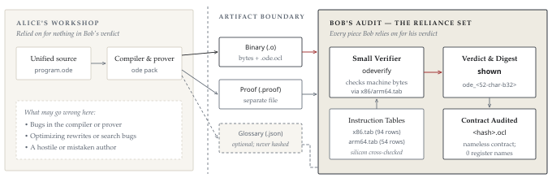
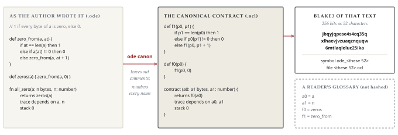
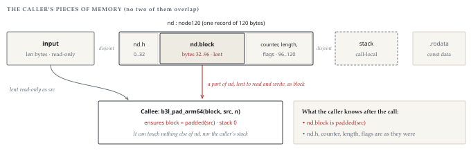
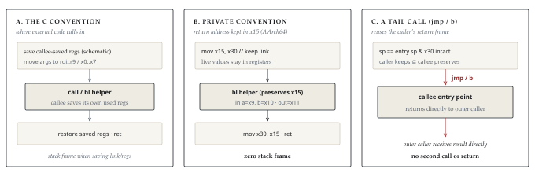
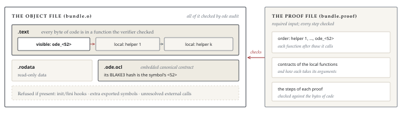
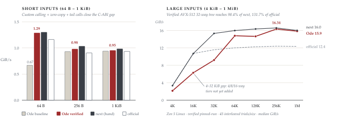

# Ode — A Language for Native Machine Code That Carries Its Proof

*Language Report & Reference · Revision 8 · November 2026*

> *“Make the promise small, keep the machine visible, and let the reader check the bytes.”*

**Typeset PDF monograph (14 pages, Tufte/Bringhurst margin grid):** [`ODE.pdf`](ODE.pdf) (built from [`ode.typ`](ode.typ) and [`make_figures.py`](make_figures.py) via `pypy3 paper/render-paper.py`).

Suppose you need a fast cryptographic hash, parser, or memory routine compiled to native x86-64 or AArch64 machine code. You did not write it, and you do not wish to read three thousand lines of assembly or rely on a compiler you cannot inspect. Running a hundred test vectors confirms that the binary gives the right answers on those hundred inputs. It tells you nothing about the next input, nothing about out-of-bounds reads, and nothing about whether a branch inside the binary depends on key material.

Ode separates what a routine *promises* from how it is *built*. The promise is a short, self-contained mathematical specification called a **contract**. The maker writes native machine instructions for each target processor and produces two files: the compiled object file and a separate proof certificate. You—the auditor, whom we call **Bob**—run a small verifier on the binary's actual bytes against the contract. You need not read the source code, and the verdict does not rely on the author, the compiler, the assembler, or the prover.



*Figure 1. The boundary between maker and auditor. Alice's workshop (left) compiles Ode source and searches for proofs, but Bob's verdict relies on none of it. Bob's reliance set (right) contains only the canonical contract he reads, the small verifier, and the processor instruction tables.*

---

## 1. Design Principles

Four decisions govern every construct in Ode. Whenever a proposed feature conflicts with one of them, the feature gives way.

1. **Minimize Bob's reliance set.** A maker wants fast proof search and convenient notation; an auditor wants as little code as possible between the contract he reads and the machine bytes he runs. Ode resolves that tension by splitting *proving* from *verifying*. Everything clever—symbolic search, arithmetic heuristics, performance advice, source syntax—lives on Alice's side. Only a small deterministic verifier reads the compiled object bytes, checks every step of the proof file, and confirms that the contract covers 100% of executable code.
2. **Never hide the processor.** High-level systems languages regularly insert hidden stack frames, silent register moves, or compiler rewrites that defeat both performance engineering and timing audits. In Ode, raw processor instructions are valid source statements. Higher-level forms expand in fixed, visible ways chosen by the coder. If a requested form cannot encode with the stated registers, the compiler reports the conflict at the source line; it never inserts a move, spills a register, or substitutes a slower sequence to make compilation succeed.
3. **Closed-world contracts.** A contract states everything a routine may assume and everything it may do: which memory ranges it may read or write, how many bytes of stack it may use (including callees), which CPU extensions it needs, why its loops and recursion terminate, and what values may influence its execution trace. Bytes outside the permitted write ranges remain equal to their entry values.
4. **Two architectures from the start.** Designing a language for one processor hides accidental assumptions inside the model. Ode targets both x86-64 (System V AMD64) and AArch64 (AAPCS64) from day one, under the same verifier and the same soundness theorems. Every contract is architecture-neutral: an x86-64 binary and an AArch64 binary implementing the same specification share the exact same contract text and the exact same 52-character content hash.

---

## 2. Values, Specifications, and Nameless Contracts

A specification defines mathematical values without prescribing how a processor computes them. An auditor can read a specification as pure mathematics and test it on concrete inputs with `ode spec-test`, while the verifier proves that a compiled binary satisfies it for *every* allowed input.

### 2.1 Types and Partiality

Specifications distinguish exact mathematical integers from fixed-width machine words and from memory addresses. The table below lists each specification type, its value domain, and its arithmetic rules.

| Type | Domain | Operations and rules |
| :--- | :--- | :--- |
| `number` | Nonnegative integers `0, 1, 2, ...` | Exact arithmetic; subtraction below zero is an explicit failure, not wraparound. |
| `byte` | Integers `0..255` | Unsigned octet; slices `a[i]` of a `bytes` piece yield a `byte`. |
| `word` | 32-bit unsigned integers | Wrapping arithmetic modulo 2^32; bitwise `&`, `|`, `^`, shifts, `ror`. |
| `counter` | 64-bit unsigned integers | Wrapping 64-bit counter (used for block and chunk counters). |
| `bytes` / `list` | Finite 0-indexed sequences | `len(xs)`, `xs[i]`, slice `xs[a .. b]` (includes `a`, excludes `b`), `words(xs)` / `bytes_of(ws)` little-endian 4-byte conversion. |
| `record` | Named fields with fixed offsets | Declared via `layout`; maps byte ranges to named fields (`nd.h`, `nd.block`, `nd.flags`). |

Two symbols keep mathematics separate from machine effects throughout Ode. Equality is written `==` (a pure predicate with no effect on operands), while storing into a register or memory is written `:=`. A bare `=` appears only where a name is bound to a definition (`const`, `let`, or `reg`).

Definitions are pure equations introduced by `const`, `def`, and `sequence`. A `def` body may bind intermediate names with `let` (each name bound at most once) and may declare explicit error cases with `fails REASON if COND`. A `sequence` defines a recurrence by its base equation `h[0] = E0` and step equation `h[b + 1] = E1`.

### 2.2 Nameless Contracts and Content Identity

In ordinary software ecosystems, names are chosen by authors and are therefore an attack surface: a misleading function name or a subtle comment can steer an auditor's eye away from a weakened condition. Ode eliminates author-chosen names from the artifact Bob audits.

An Ode contract has *no name*. When `ode canon` produces the canonical Ode Contract Language (`.ocl`) form, it performs four deterministic steps:

1. Removes all comments and normalizes whitespace.
2. Drops every helper `def`, `const`, or `layout` not reachable from the contract.
3. Replaces every chosen identifier with a numbered slot in canonical order of first mention (`f0`, `f1`, ... for definitions; `a0`, `a1`, ... for contract arguments; `p0`, `p1`, ... for parameters).
4. Refuses any `calling` block or register name—hardware calling details never enter an auditor's `.ocl` contract.

The sole identifier of that contract is the 52-character lowercase RFC 4648 base-32 BLAKE3-256 digest of its canonical `.ocl` text (never truncated). Every exported linker symbol is derived directly from that digest (`ode_<52>`), and standalone `.ocl` files carry `<52>.ocl` as their filename. Whenever `ode audit` or `ode spec-test` reads a hash-named `.ocl` file, it hashes the contents and refuses if the digest does not match the filename. A personal *glossary* maps slots back to readable words (`a0 -> "a"`, `f0 -> "all_zero"`), belongs to its reader, and is never hashed.



*Figure 2. From author's names to canonical content identity. Running `ode canon` on `all_zero` strips comments, drops unreachable helpers, and numbers every identifier into a 14-line nameless `.ocl` contract whose BLAKE3-256 digest (`jbqyjqpese4s4cq35qxlhaevjvzuaqznquqw6mtlaqleluc25ika`) binds both the filename and the linker symbol.*

---

## 3. What a Contract Promises: Memory, Stack, and Trace

If a caller meets every `requires` clause on entry, a verified function is guaranteed to terminate, return cleanly, satisfy every `ensures` and `returns` clause, stay within its `stack` budget and `needs` CPU features, and produce an execution trace determined solely by its `trace depends on` clause. For inputs outside `requires`, the contract makes no promise.

### 3.1 Memory Pieces, Disjointness, and Lending

Every pointer argument names a *piece* of memory: a starting address, a length (fixed, such as `32 bytes` or `block`, or parameterized by another argument, such as `a: n bytes`), and an access permission. By default, every memory parameter is read-only. Mentioning a piece on the left side of `ensures p = E` or in `writes p` grants write permission for that piece alone.

The precondition `no_overlap(p1, p2, ...)` states that no two of the listed byte ranges have any byte in common. Because Ode uses explicit ownership lending across calls, a caller may lend either a whole piece or a contiguous sub-span (such as `nd.block`, bytes `32..96` of a 120-byte `node120` record) to a callee, provided it lends no more bytes and no greater permission than it holds. On return, the verifier updates the caller's knowledge of the lent sub-span with the callee's postcondition while preserving every proven fact about the remaining bytes of the caller's memory.



*Figure 3. Closed-world memory pieces, disjointness, and sub-span lending. The caller holds pairwise disjoint pieces and lends only `nd.block` (read/write) and `input` (read-only) to `b3l_pad_fast`. Other fields of `nd`—`h`, `t`, `blen`, and `flags`—automatically retain their proven values across the call.*

Stack space is strictly call-local: a function may allocate up to its declared `stack N` bytes (which may be a formula such as `18688 + 384 * bits(len / 1024)` for recursive trees), may lend slices of its stack frame to callees, and must restore the stack pointer before returning. No address inside a stack frame outlives its call. Read-only program constants (`.rodata`) belong to the loaded program and may never be written.

### 3.2 Architectural Trace (`trace depends on`)

When a binary runs, the processor executes a sequence of instructions and accesses a sequence of memory addresses. That sequence of instruction addresses and memory addresses is the function's *architectural trace*. An observer who measures execution time or cache-line activity learns information about this trace, not directly about values kept in registers. (Ode proves architectural trace equivalence; it does not model speculative execution, power draw, or analog side channels.)

A contract's `trace depends on` line is a two-run noninterference theorem: *given any two valid calls whose listed trace expressions and pointer addresses agree, both runs execute the exact same sequence of instructions and touch the exact same memory addresses, regardless of how other inputs differ.*

Consider two implementations of byte-array comparison returning `same(a, b)` (`1` if equal, `0` otherwise):

- An early-exit loop (`equal`) branches on the first differing byte `a[i] != b[i]`. Its trace reveals where the arrays first differ, so the verifier insists that its contract say `trace depends on a, b, n`.
- A branchless loop (`equal_ct`) folds byte differences into an accumulator without branching on any byte. Its trace depends solely on the array length, so the verifier approves `trace depends on n`—keeping both `a` and `b` out of the trace even though the returned number is computed from them.

Crucially, `trace depends on` may list *computed expressions*, not only raw inputs. A tag-checking function compares an incoming tag against an expected tag without branching on individual bytes, and then branches once to accept or reject:

```ode
contract verify_tag(want: n bytes, tag: n bytes, n: number) {
    returns same(want, tag)
    trace depends on n, same(want, tag)
    stack 0
}
```

Inside each function, a branch condition or memory offset may depend only on constants, entry addresses, and values computed from what *that function's own* `trace depends on` line lists. A function whose contract specifies `returns E` places no extra trace burden on its return register; if a caller later branches on that returned number, the *caller's* `trace depends on` line must allow what `E` is computed from (established by a `clear` proof step when an expression equals a listed trace value). For abstract return contracts (`returns r` with `ensures`), an optional `result depends on` clause states which inputs may affect `r`.

---

## 4. Writing Code: Unified `.ode` Source Across Two Processors

Every Ode program is written in one source file format (`.ode`). Each `.ode` file forms a *closed local namespace*—there is no implicit cross-file symbol merging. Every callable `fn` must declare its contract directly in its header, followed by one or more explicit processor implementation blocks (`for x86_64` and `for arm64`).

### 4.1 Structured Notation Without Silent Rewrites

Ode gives the coder concise ways to avoid assembly tedium while preserving complete control over emitted bytes:

- **Register aliases** (`reg name = rdi`) bind readable names to concrete architectural registers inside a function body and its `place` invariants.
- **Structured stack frames** (`frame { buf: 64 bytes; saved: 1 * u64 }`) compute byte offsets (`frame.buf`, `frame.size`) and enforce declared alignments and bounds.
- **Checked inline templates** (`inline fn`) replace raw text macros. An `inline fn` declares the register class of each operand (`gpr`, `vec`), which operands must be distinct (`distinct(dst, tmp)`), and which registers it modifies (`changes tmp`). Passing the same register for destination and scratch is refused at the source line before a single byte is assembled.
- **Constant-range unrolling** (`for i in 0..8 { ... }`) repeats a fixed block over compile-time indices.
- **Inline loop invariants** (`place { name ... fact ... decreases ... }`) sit right at the loop head where the verifier checks them on entry and across every back-edge—never in a fragile side file keyed by yesterday's byte offsets.

### 4.2 Figure 4: One Contract, Two Processors (`all_zero`)

Below is a real verified routine from `proof-core/examples/verifier/`: `all_zero`, which scans `a[0 .. n]` and returns `1` if every byte is zero and `0` otherwise. Both processor bodies satisfy the exact same 14-line nameless `.ocl` contract (`BLAKE3: jbqyjqpese4s4cq35qxlhaevjvzuaqznquqw6mtlaqleluc25ika`) with zero stack bytes.

```ode
// Shared contract (canonical .ocl BLAKE3: jbqyjqpese4s4cq35qxlhaevjvzuaqznquqw6mtlaqleluc25ika)
fn all_zero(a: n bytes, n: number)
  returns zero_from(a, 0)
  trace depends on a, n
  stack 0
{
  for x86_64 {
    reg base = rdi; reg limit = rsi; reg idx = rcx
    idx := 0
  @loop:
    place { name i = idx; fact i <= n; fact zero_prefix(a, i); decreases n - i }
    cmp idx, limit
    jae @done
    movzx eax, byte ptr [base + idx]
    test eax, eax
    jne @no
    add idx, 1
    jmp @loop
  @done:
    mov eax, 1
    ret
  @no:
    xor eax, eax
    ret
  }

  for arm64 {
    reg base = x0; reg limit = x1; reg idx = x2
    idx := 0
  @loop:
    place { name i = idx; fact i <= n; fact zero_prefix(a, i); decreases n - i }
    cmp idx, limit
    b.hs @done
    ldrb w3, [base, idx]
    cbnz w3, @no
    add idx, idx, #1
    b @loop
  @done:
    mov x0, #1
    ret
  @no:
    mov x0, #0
    ret
  }
}
```

### 4.3 Verified Instruction Tables

The verifier does not rely on a separate compiler backend or an ad-hoc semantics scattered through code. Every machine instruction is defined as a declarative row in a small human-readable table:

- **`core/x86.tab`** (94 rows): 64-bit/32-bit GPR arithmetic, branches, conditional moves, SSE/AVX2/AVX-512 128-, 256-, and 512-bit SIMD lanes, and aligned/unaligned memory operations.
- **`arm64/arm64.tab`** (54 rows): a standalone AArch64 specification package that names nothing of Ode's verifier or contracts. Every row is cross-checked on real Apple Silicon hardware and formally proved in `arm64/agree/Agree.lean` (54/54 rows, zero `sorry`) to agree with Google DeepMind's `arm64-semantics`.

---

## 5. Calls, Custom Calling Conventions, and Verified Tail Calls

### 5.1 C ABI at the Boundary, Ode ABI Inside

Externally callable entry points (functions invoked from Rust or C) follow the platform's standard C calling convention (System V AMD64 on x86-64; AAPCS64 on AArch64). Between two Ode functions inside one verified bundle, the C convention is needlessly expensive: it forces arguments into fixed registers and forces small helpers to spill callee-saved registers onto the stack even when the caller has spare scratch registers ready.

Because an Ode helper is marked `STB_LOCAL` (not exported outside its bundle), its target block may carry a `calling { ... }` declaration:

```ode
fn pad_fast(block: 64 bytes, src: n bytes, n: number)
  requires n <= 64
  requires no_overlap(block, src)
  ensures block = padded(src)
  trace depends on n
  stack 0
{
  for x86_64 calling {
    in block = rdi, src = rsi, n = rdx
    preserves rbx, rbp, r8, r9, r10, r11, r12, r13, r14, r15
  } { ... }
}
```

The `calling` block specifies which registers receive each argument (`in`), which register holds the return value (`out`, if any), and which general-purpose (`preserves`) and SIMD vector (`preserves_vec`) registers the callee promises to leave unchanged. On AArch64, this unlocks zero-stack non-leaf callers: a caller moves its link register `x30` into a register preserved by the callee (such as `x15`), executes `bl callee`, restores `mov x30, x15`, and returns with `stack 0`—zero `stp`/`ldp` frame traffic.

### 5.2 Calling-Convention Soundness Invariants

Every `calling` block is enforced by the verifier (and never allowed in `.ocl`):
1. All `in` registers are distinct and cannot be the stack pointer (`rsp`/`sp`) or AArch64 link register (`x30`).
2. `preserves` and `preserves_vec` contain only registers of the matching class and never include `out` or `x30`.
3. A `stack 0` callee cannot touch caller stack memory; after a call, any caller register not in `preserves` is wiped to unknown in the verifier's symbolic state.

### 5.3 Verified Tail Calls (`jmp` and `b`)

When a caller's final action is to delegate directly to another verified function (`jmp target` on x86-64, `b target` on AArch64), Ode verifies the transfer as a *direct tail call* with zero extra instruction-table rows and zero stack-frame growth:

1. **Stack restored:** The caller's stack pointer must equal its entry value (`rsp == rsp_0` or `sp == sp_0`), so the callee inherits the caller's original return address as it stood on entry and the combined peak stack stays within `caller.stack`.
2. **Return compatibility:** The callee's `out` register and every caller-preserved register (`callee.preserves` superset of `caller.preserves`) must match the caller's contract on exit.
3. **Postcondition and trace handoff:** Every callee `requires` and `no_overlap` condition holds at the jump; every byte outside the callee's lent write pieces already satisfies the caller's postcondition; the callee's `ensures` and `returns` imply the caller's; and the callee's `trace depends on` expressions are determined by the caller's trace clause.



*Figure 5. Custom calling conventions and verified tail calls. Eliminating C-ABI register shuffles and stack-frame prologues lets a caller jump directly into a leaf routine (`jmp` / `b`) or hold AArch64's link register `x30` in a callee-preserved GPR (`x15`) with zero stack bytes.*

---

## 6. Bundling, Proofs, and Bob's Audit

Ode ships one minimal set of artifacts across the boundary between Alice and Bob:

- **One binary (`program.o`)**: a standard ELF64 (x86-64) or Mach-O/ELF64 (AArch64) object file containing executable `.text`, read-only `.rodata`, and an embedded `.ode.ocl` section carrying the canonical nameless contract for each exported `STB_GLOBAL` entry point. Every internal helper is `STB_LOCAL` and carries no `.ode.ocl`.
- **One proof certificate (`program.proof`)**: a plain, separate file outside the binary holding the verification steps for every function in the bundle and the `calling` declarations of internal helpers.
- **One command for Bob (`ode audit`)**: Bob runs a single deterministic check—optionally pinning his expected 52-character contract digest via `--expect-contract <hash>`—and receives one of four exact verdicts.



*Figure 6. Multi-function bundle structure and Bob's audit. `ode audit` reads the object's `.text` and `.ode.ocl` directly, hashes the canonical contract, verifies every function in the bundle, and confirms 100% instruction coverage before reporting `shown`.*

### 6.1 The Four Exact Verdicts

Ode tools never print ambiguous words like "ok" or "verified". Every tool reports one of four exact verdicts:

| Verdict | Meaning |
| :--- | :--- |
| **`shown`** | The deterministic verifier checked every machine byte and every proof step and proved the binary satisfies its contract and trace rule. |
| **`refused with a proof`** | The verifier found a concrete mismatch or counterexample demonstrating that the binary violates the contract or proof step. |
| **`no proof found`** | Alice's prover could not discover a proof within its search budget (says nothing about truth; Bob never runs the prover). |
| **`run`** | Concrete test vectors were executed against the specification or binary (`ode spec-test`); a test is never a proof. |

---

## 7. Proof by Construction: Verified BLAKE3 and Breadth

A language for verified native code must prove its worth on demanding, real-world workloads—not toy arithmetic loops. Our primary benchmark is single-threaded BLAKE3 against hand-tuned assembly in `BLAKE3-Servil` (`next`) and the official `blake3` crate (`1.8.7`).

### 7.1 Fast Short-Input and Large-Input x86-64 BLAKE3

Our verified x86-64 BLAKE3 bundle consists of 17 functions (3,202 machine instructions, 17,278 bytes of `.text`, 1 exported symbol, 0 hooks) audited in one `ode audit` pass as `shown` against canonical contract `7jb2pyzuwz6tqd3qmjsra3mk36tl4547sfpy3at5scbk772lbila` (95 canonical lines). Applying custom calling conventions and verified tail calls transformed short-input performance without changing a single byte of the canonical contract:

- **64-byte inputs:** a 12-instruction zero-copy, zero-stack path in `b3l_hashr` loads the key, sets flags, and tail-jumps (`jmp`) directly into `blake3_servil_compress_in_place_avx512` (or `sse41`)—raising Zen 5 throughput from **0.670 GiB/s** (C-ABI baseline) to **1.286 GiB/s** (`98.9%` of hand-tuned `next`, `110.8%` of official `blake3 1.8.7`).
- **Single-block chunks (`<= 64 B`):** `b3l_chunk_node_fast` uses zero callee-saved spills and tail-jumps directly into custom-calling `b3l_pad_fast` (`stack 0`).
- **Inputs above 1 KiB:** a single-instruction `jmp b3l_hashr_long` enters the verified AVX-512 32-way tree, reaching **16.336 GiB/s** at 256 KiB (`98.4%` of `next`, `131.7%` of official) and **15.851 GiB/s** at 1 MiB (`98.9%` of `next`, `128.3%` of official).



*Figure 7. Verified BLAKE3 throughput on Zen 5 (64 B to 1 MiB). Verified pinned-run medians (45 interleaved trials per size). Short inputs (left) jumped from 0.67 to 1.29 GiB/s via custom calling and tail calls; large inputs (right) match 98.4–98.9% of hand-tuned `next` and beat official BLAKE3 by 28–32%. Medium sizes (4–32 KiB) remain slower because 4/8/16-way AVX-512 tiers are not yet added.*

### 7.2 AArch64 BLAKE3 and Program Breadth

The table below summarizes our verified programs across both x86-64 and AArch64, giving each routine's verified scope and measured silicon throughput.

| Program | Target | Verified scope | Measured performance & status |
| :--- | :--- | :--- | :--- |
| `b3l_hashr` (BLAKE3) | x86-64 | 17 fns · 3,202 insns | **1.286 GiB/s** (64 B, 98.9% `next`); **16.336 GiB/s** (256 KiB, 98.4% `next`). 4 SIMD kernels checked from `.S` bytes. |
| `b3l_hashr_arm64` (BLAKE3) | AArch64 | 7 fns · 1,832 insns | 100% Ode source (4-way NEON): **2.194 GiB/s** (16 KiB, Apple M6, 84.4% official); short / 4 KiB speedup next. |
| 20-round ChaCha20 | x86-64 & Arm | 4-way / 16-way SIMD | **9.412 GiB/s** on Zen 5; **1.701 GiB/s** on Apple M6. Full RFC 8439 verification. |
| Spec-First Factory | x86-64 & Arm | 38 verified functions | Base64, UTF-8, DER, Adler-32, LZ4, SHA-256, varint, and verifier building blocks—all verified `shown`. |

---

## 8. Reliance Sets, Verification Routes, and Open Frontiers

Ode is designed so that Bob does not have to accept the verifier's soundness without checking, and does not have to rely on any single foundation. Instead, the architecture supports four independent routes to justified confidence in `odeverify`:

| Route for Bob | What it establishes | Current status |
| :--- | :--- | :--- |
| **1. Lean 4 soundness proof** | Machine-checked proof that if `odeverify` returns `shown`, the binary satisfies its contract and trace rule under standard axioms (`propext`, `Classical.choice`, `Quot.sound`). | Complete: 11 top-level theorems in `test_sound.py`, zero `sorry`, covers x86-64, AArch64, calling conventions, and tail calls. |
| **2. Instruction-table validation** | Confirms that `x86.tab` (94 rows) and `arm64.tab` (54 rows) match real processors and external formal ISA models. | All 54 `arm64.tab` rows cross-checked on Apple M6 silicon *and* proved in `arm64/agree/Agree.lean` against Google DeepMind's `arm64-semantics`. |
| **3. Read or re-implement the kernel** | Bob reads a small verifier himself or checks the same `.proof` file with an independent second verifier written in another language. | Open: `proof-core/Core.lean` is currently 5,123 lines (9,651 lines across verifier + model files). Shrinking it is a top priority. |
| **4. Self-verifying Ode verifier** | The verifier itself is written in Ode and verified against its own specification, breaking circularity via any one outside check. | Early building blocks verified on both x86-64 and AArch64 (`examples/verifier/`: `all_zero`, `xor64`, `fold32`, `arith`). |

Four concrete engineering frontiers remain open and deliberately staged:

1. **Short-input and 4 KiB AArch64 BLAKE3** applying zero-copy 64-byte tail jumps (`b`) and `stack 0` link-register-in-`x15` callers on Apple Silicon.
2. **Explicit linked local namespaces** (`use alias = "file.ode"` and `alias.name`) so multi-file programs pack with plain `ode pack` instead of bespoke build scripts, without ever merging global namespaces.
3. **Shrinking `Core.lean` and building an independent second verifier** alongside wiring `ode audit` directly into `blake3-servil-core`'s build script.
4. **Full single-threaded `blake3-servil-core` coverage** (incremental `Hasher`, keyed and derive-key modes, intermediate x86-64 4/8/16-way tiers) and settling whether x86-64 AVX-512 kernels are rewritten in Ode source or kept as byte-verified assembly.

### 8.1 Revision 8 Meter Baseline

The table below records exact counts for both discipline meters at Revision 8, so future simplification and feature rounds can be measured against an explicit baseline.

| Measurement | Revision 8 value | What it counts |
| :--- | ---: | :--- |
| **Meter 1 — Report length** | 14 pages | Complete language definition, 7 figures, 5 tables, and 1-page EBNF appendix (`ODE.pdf`). |
| **Meter 1 — Surface grammar** | 40 productions | 24 `.ocl` specification/contract productions + 16 `.ode` source productions (Appendix A). |
| **Meter 2 — Verifier core** | 5,123 lines | `proof-core/Core.lean` (9,651 lines including `Machine`, `Contract`, `Trace`, `Plain`, `Reader`, `Table`, `Arithmetic`). |
| **Meter 2 — Soundness proofs** | 32,684 lines | `proof-core/Sound*.lean` proving 11 top-level theorems (standard Lean axioms only; zero `sorry`). |
| **Instruction tables** | 94 + 54 rows | `core/x86.tab` (94 rows) and standalone `arm64/arm64.tab` (54 rows, 54/54 proved against Google's model). |
| **Full BLAKE3 audit** | 17 fns · 3,202 insns | Verified `shown` in one `ode audit` pass against a 95-line `.ocl` contract (455 KiB combined proof). |

---

## Appendix A · Complete Surface Grammar of Ode and `.ocl`

Extended Backus–Naur Form (EBNF) of the unified `.ode` source language and its canonical `.ocl` contract subset. Brackets `[ ... ]` denote optional items; braces `{ ... }` denote zero or more repetitions; quoted strings denote literal tokens. An `.ocl` file contains only `const`, `def`, `sequence`, `layout`, `kind`, and one nameless `contract`—never `fn`, `data`, `inline fn`, `calling`, or register names.

### Specification & Canonical `.ocl` Subset (24 productions)

```ebnf
OclFile        = { SpecDecl } NamelessContract .
SpecDecl       = ConstDecl | DefDecl | SeqDecl | LayoutDecl | KindDecl .

ConstDecl      = "const" ident "=" Expr .
DefDecl        = "def" ident "(" [ IdList ] ")" [ ":" Kind ] "{" { LetOrFail } Expr "}" .
LetOrFail      = "let" ident "=" Expr
               | "let" ident "[" "0" "]" "=" Expr
               | "let" ident "[" ident "+" "1" "]" "=" Expr
               | "fails" Expr "if" Expr .

SeqDecl        = "sequence" ident "(" [ IdList ] ")" "{"
                 ident "[" "0" "]" "=" Expr
                 ident "[" ident "+" "1" "]" "=" Expr
                 [ "for" ident "in" "0" ".." Expr ] "}" .

LayoutDecl     = "layout" ident num "{" Field { "," Field } "}" .
Field          = ident [ "[" num "]" ] ":" Kind "at" num [ "below" num ] .
KindDecl       = "kind" ident ":" Kind .
Kind           = "number" | "byte" | "word" | "counter" | "any" | ident | ( num | ident ) "bytes" .

NamelessContract = "contract" "(" [ ParamList ] ")" "{" { ContractClause } "}" .
ParamList      = Param { "," Param } .
Param          = ident ":" Kind .

ContractClause = "requires" Expr
               | "ensures" ident "=" Expr
               | "returns" Expr
               | "writes" ident
               | "trace" "depends" "on" ExprList
               | "result" "depends" "on" ExprList
               | "stack" Expr
               | "decreases" Expr
               | "needs" ident [ "if" Expr ] .

Expr           = "if" Expr "then" Expr "else" Expr
               | "[" Expr "for" ident "in" Expr ".." Expr "]"
               | OrExpr .
OrExpr         = AndExpr { "||" AndExpr } .
AndExpr        = RelExpr { "&&" RelExpr } .
RelExpr        = AddExpr [ RelOp AddExpr ] .
RelOp          = "==" | "!=" | "<" | "<=" | ">" | ">=" .
AddExpr        = MulExpr { ("+"|"-"|"|"|"^") MulExpr } .
MulExpr        = Unary { ("*"|"/"|"%"|"&"|"<<"|">>"|"ror") Unary } .
Unary          = ("-" | "!" | "~") Unary | Postfix .
Postfix        = Primary { "[" Expr [ ".." Expr ] "]" | "." ident | "(" [ ExprList ] ")" } .
Primary        = num | ident | "(" Expr ")" | "[" [ ExprList ] "]" .
```

### Unified `.ode` Source & Target Implementations (16 productions)

```ebnf
OdeFile        = { SpecDecl | DataDecl | InlineFn | FnDecl } .
DataDecl       = "data" ident "{" { num | string } "}" .

InlineFn       = "inline" "fn" ident "(" [ RegParamList ] ")"
                 { "distinct" "(" IdList ")" | "changes" IdList }
                 "{" { AsmStmt } "}" .
RegParam       = ident ":" ( "gpr" | "vec" ) .

FnDecl         = "fn" ident "(" [ ParamList ] ")" [ "as" string ]
                 { ContractClause }
                 "{" TargetBlock { TargetBlock } "}" .

TargetBlock    = "for" ( "x86_64" | "arm64" )
                 { "stack" Expr | "needs" ident [ "if" Expr ] | CallingBlock }
                 "{" { BodyItem } "}" .

CallingBlock   = "calling" "{"
                 [ "in" Bind { "," Bind } ]
                 [ "out" "=" Reg ]
                 [ "preserves" [ RegList ] ]
                 [ "preserves_vec" [ RegList ] ]
                 "}" .
Bind           = ident "=" Reg .

BodyItem       = BudgetBlock | FrameBlock | RegAlias | PlaceBlock | ForUnroll | Label | AsmStmt .
BudgetBlock    = "budget" "{" { ident num } "}" .
FrameBlock     = "frame" "{" { ident ":" FrameField } "}" .
RegAlias       = "reg" ident "=" Reg .
PlaceBlock     = "place" "{" { "name" ident "=" Reg | "fact" Expr
                             | "wrote" ident "[" Expr ".." [ Expr ] "]" "=" Expr
                             | "decreases" Expr } "}" .
ForUnroll      = "for" ident "in" num ".." num "{" { BodyItem } "}" .
Label          = "@" ident ":" .
AsmStmt        = RawInstruction
               | Reg ":=" Expr
               | ident "(" [ RegList ] ")"
               | ( "call" | "jmp" | "bl" | "b" ) ident .
```

### Command Summary (`lang/ode_tool.py`)

| Command | Purpose |
| :--- | :--- |
| `ode canon FILE [--out-dir D]` | Canonicalize to `<52-b32>.ocl` |
| `ode pack SRC --fn F -o O -p P` | Compile, prove, bundle, and audit |
| `ode audit OBJ --proof P` | Bob's sole verification check |
| `ode spec-test FILE --call F ...` | Run concrete specification tests |
| `ode advice SRC --fn F` | Advisory micro-op & cache metrics |
